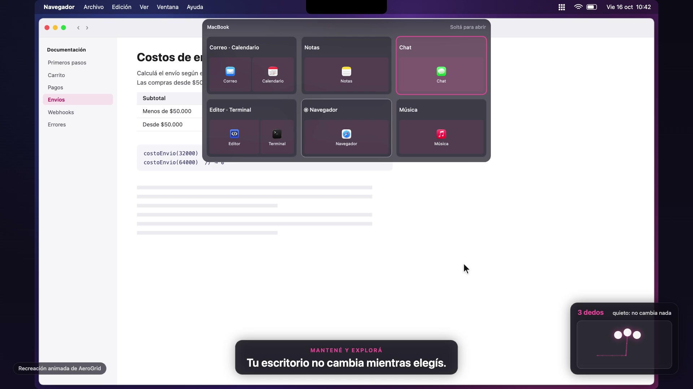

<div align="center">

# AeroGrid

**A spatial home for your Mac’s windows.**

Arrange apps visually. Move between spaces with your trackpad. Keep your setup when you unplug.

[](#requirements)
[](#build-and-install)
[](#project-status)

[🎬 Watch the demo](docs/media/AeroGrid-Demo-Opus.mp4) · [🚀 Get started](#build-and-install) · [📖 Guía en español](BUILD-ON-ANOTHER-MAC.md)

</div>

[](docs/media/AeroGrid-Demo-Opus.mp4)

> 🎬 **80-second animated demo**, created with Claude Opus. Shows everyday navigation, held-gesture previews, drag-and-drop organization, and coordinated displays. This is an animated recreation with fictional content, not a screen recording. [Download MP4](https://raw.githubusercontent.com/fferrioli/aerogrid/main/docs/media/AeroGrid-Demo-Opus.mp4) · [Animation source and storyboard](demo/)

## 🗺️ Your apps have a place

Keep conversations on the left, browsers in the middle, and editors on the right. AeroGrid gives your work a spatial map: each space can contain one app, a split layout, or a stack of windows. Positions stay meaningful as you add, move, or resize spaces.

AeroGrid is a native macOS menu bar app built around a bundled, modified [AeroSpace](https://github.com/nikitabobko/AeroSpace) window engine. You organize through AeroGrid’s interface; no keyboard shortcuts or separate AeroSpace installation are required.

## ✨ What you can do

| | |
|---|---|
| 🧭 **Navigate in every direction** | Swipe left, right, up, or down. Hold contact to explore the map, then lift to open your selection. |
| 🪄 **Organize visually** | Open a floating overview with a menu bar click or a brief hover at the top center of the screen. Drag app cards between spaces. |
| 🧩 **See the arrangement** | Each space shows app icons in their actual split or stacked layout. Titles reflect the apps inside. |
| 📦 **Move whole setups** | Drag a space by its header to move or reorder it while keeping its apps and arrangement together. Undo organization changes. |
| 🖥️ **Work across displays** | Navigate only the display under your pointer or move all displays together. Each connected display has its own board. |
| 🔌 **Unplug without losing your place** | Parallel app groups become neighboring spaces on the laptop. Existing stacks stay together. Reconnect to restore unchanged groups. |
| 🔲 **Keep fullscreen reachable** | An app entering native fullscreen gets a neighboring destination when it was sharing a space with other apps. |

## 🧑‍💻 A typical workflow

1. Put an editor beside a terminal in one space, research in another, and chat nearby.
2. Swipe with three fingers to move between them. Keep your fingers down and continue moving to preview more destinations; lift to choose.
3. Hover near the camera area to open **Tus espacios**. Drag an app to a different space, an empty destination, or a **+**.
4. Drop on a window’s edge to split the layout, or in its center to stack. Drag a space’s header to move the entire setup.

The map grows from the spaces you use. Intentional gaps preserve your columns; navigation skips those gaps while keeping explicitly created empty spaces reachable.

## 🖐️ Gestures

These are the default bindings. Settings lets you change finger counts, directions, modifiers, scope, and display targeting.

| Gesture | Result |
|---|---|
| **3-finger swipe** in any direction | Navigate the display under the pointer |
| **4-finger swipe** in any direction | Navigate all connected displays together |
| **Continue moving without lifting** | Explore further destinations in the preview |
| **Lift your fingers** | Open the final selection |
| **Return to the starting space, then lift** | Cancel the selection |

A quick flick moves one neighbor. After holding contact briefly, further movement explores the map; resting your fingers does not repeat navigation.

Remap conflicting gestures in **System Settings → Trackpad → More Gestures** and, if enabled, three-finger dragging in Accessibility. AeroGrid does not change macOS gesture preferences for you.

<a id="build-and-install"></a>

## 🚀 Build and install

The current installation path is to build from source. Both the app and its matching window engine are included in this repository.

<a id="requirements"></a>

### 🧰 Requirements

- **macOS 14 or later** to run AeroGrid.
- **Swift 6.2 or later** and a compatible macOS SDK from Xcode or Command Line Tools. The build toolchain has its own macOS requirements.
- **Python 3.9 or later** for installation.
- A compatible multitouch trackpad for gesture navigation, and internet access for the initial Swift dependency download.

### 1. 🔨 Build

```sh
git clone https://github.com/fferrioli/aerogrid.git
cd aerogrid
zsh scripts/build.sh
```

### 2. 📦 Install

Quit other window managers first. If updating AeroGrid, choose **Salir de AeroGrid** from its menu before replacing the installed apps.

```sh
python3 scripts/install.py
open "$HOME/Applications/AeroGrid.app"
```

Installation is per user and requires no `sudo`. The installer backs up existing AeroSpace configuration, preserves unrelated rules, and creates a minimal configuration on a clean Mac. The original AeroSpace app is kept available.

### 3. 🔐 Allow Accessibility

In **System Settings → Privacy & Security → Accessibility**, enable both:

- **AeroGrid** — gestures and the interface.
- **AeroGrid Backend** — window management.

If an entry is missing, add its app from `~/Applications` with **+**. Then click **Recover / Recuperar** in AeroGrid.

AeroGrid uses one menu bar icon. Click it to organize; right-click for settings, recovery, pause/resume, and quit. Pause stops both gesture input and window management. Start at login is optional in settings.

Local builds use ad-hoc signing and do not require a paid Apple Developer membership. There is currently no notarized release; managed Macs may restrict locally built apps too. See the [Spanish installation guide](BUILD-ON-ANOTHER-MAC.md) for a step-by-step walkthrough.

## 🔌 From ultrawide to laptop

With both displays connected, the overview keeps their spaces on separate boards. Three-finger navigation follows the active display; four-finger navigation coordinates both.

When the external display is disconnected, parallel layout groups become separate, reachable spaces in the laptop’s map. A group that was already stacked stays stacked. For example:

| On the ultrawide | On the laptop |
|---|---|
| Editor beside a terminal | One editor space + a neighboring terminal space |
| Editor beside two stacked terminals | One editor space + a neighboring space with both terminals stacked |

All destinations are accessible with normal gestures. Reconnecting restores groups whose membership and arrangement have stayed unchanged; edits made while disconnected are preserved. **Reunir grupo** lets you explicitly reunite a group.

<a id="project-status"></a>

## 🚧 Project status

AeroGrid is an experimental personal project. Core navigation, visual organization, multi-display scopes, dock/undock adaptation, and native fullscreen have been exercised on a MacBook with an ultrawide display. Automated tests cover the model, gesture recognition, backend extensions, and installer. This is not a guarantee across every Mac or macOS release.

Current limits:

- The overview uses app icons and layout drawings. Live screenshot thumbnails are not implemented.
- Dragging happens inside the overview. Dragging a real desktop window into the camera area is not implemented.
- Native fullscreen discovery and some gesture handling depend on private macOS APIs. System updates can affect them; a never-visited native fullscreen Space may need to be visited once.
- Independent native fullscreen navigation requires **Displays have separate Spaces** in macOS.
- Some interface labels are currently in Spanish. Apple Silicon has been tested; Intel hardware has not been physically verified.

## 📚 Documentation

| Guide | Covers |
|---|---|
| [Install on another Mac — español](BUILD-ON-ANOTHER-MAC.md) | Toolchain setup, local builds, permissions, and updates |
| [Troubleshooting](docs/troubleshooting.md) | Accessibility, backend recovery, gesture conflicts, and uninstall |
| [Architecture](docs/architecture.md) | App, core model, window engine, and persisted state |
| [Development and testing](CONTRIBUTING.md) | Test commands and safe local development |
| [Upstream components](UPSTREAM.md) | Pinned revisions, fork changes, and original notices |
| [Demo source](demo/) | Opus animation, storyboard, and rendering instructions |

## 🙌 Credits and licensing

AeroGrid builds on [AeroSpace](https://github.com/nikitabobko/AeroSpace), adapts gesture input from [SwipeAeroSpace](https://github.com/MediosZ/SwipeAeroSpace), and uses [TOMLKit](https://github.com/python-poetry/tomlkit) to preserve configuration formatting. Their licenses and notices are retained in `vendor/`; see [third-party notices](THIRD_PARTY_NOTICES.md).

No project-wide license has been selected for AeroGrid’s original code yet. Public availability does not grant an additional reuse license. Third-party code and artwork retain their respective terms.
